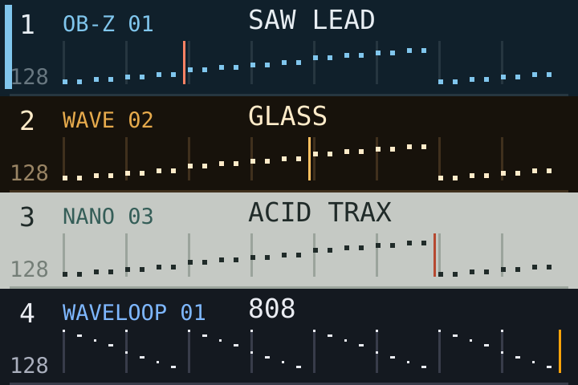

# Sequence-view module

Portable C99 for the flat HOME track view: **bank, patch, and the entire sequence**.
It renders up to 128 steps, four-note chords, fractional holds, ties, eight drum
lanes, mute/selection, recording and independent playheads.



## Files

- [sequence_view.h](sequence_view.h) / [sequence_view.c](sequence_view.c): renderer.
- [Switch Blade adapter](examples/switchblade_adapter.h): maps native steps and bank themes.
- [SVG demo](examples/demo.c): working host example, no SDK or font assets.
- [Tests](tests/sequence_view_test.c): bounds, holds, drums, final step and read-only behavior.

The host supplies rectangle/text drawing and a step reader. No audio, MIDI,
transport scheduling, storage writes, dynamic allocation or global selected theme.
Draw one row per track; each preview spans its whole active length.

```sh
cc -std=c99 -I kits/sequence_view \
  kits/sequence_view/sequence_view.c kits/bank_themes/bank_themes.c \
  kits/sequence_view/examples/demo.c -o /tmp/sequence-view
/tmp/sequence-view > /tmp/sequence-view.svg
```

## Integrate

1. Compile the renderer and supply `fm1sv_canvas` callbacks. Text callbacks must
   clip/ellipsize to their width; small/normal fonts should fit a 14-pixel band.
2. Map native steps to `fm1sv_step`. Convert legacy drum MIDI notes to lane bits
   in the adapter; a melodic duration is Q8 steps, zero uses following TIE cells.
3. Supply bank/patch labels, length, selection/mute and the current playhead.
4. Call `fm1sv_draw_track` on a dirty row. The host owns snapshot consistency and
   redraw cadence. Include step data, length, labels, palette and transport in
   dirty tracking. `fm1sv_draw_sequence` also works alone inside another widget.

Rows support widths 96..4096 and heights 38..4096. A sequence-only rectangle
needs height 16 or more. Return value is 0 on success, -1 for invalid arguments.
At 128 steps on a small display, short notes may be one pixel wide.

## Switch Blade and per-bank themes

The adapter targets [Switch Blade 4f0de78](https://github.com/ELI7VH/switchblade/tree/4f0de78c982d478e9f64388ea2c93ab771c4e2db).
Copy the renderer and [bank-theme module](../bank_themes/README.md) into the
host's build, include the adapter after `home_sound_of` in `firmware/src/ui_big.c`,
and call it for each dirty HOME row. Keep existing header, knob and footer code.
Switch Blade uses an amalgamated C build. Include the two implementation files
exactly once in `felucca.c`, before the UI includes:

```c
#include "sequence_view.c"
#include "bank_themes.c"
```

Other hosts may compile them as separate C translation units instead.

Its native seams are `seq_steps`, `step_t`, `step_hold_q8`, `drum_lane`,
`home_sound_of`, `UI_MACHINE_PALS` and the `cv_*` drawing functions.

Each row uses its own bank's palette. The adapter preserves native machine
palettes and binds the drum bank to **WaveLoop** (navy, blue and gold, bank label
WAVELOOP). This is packaged module behavior; it does not change installed units.
Other firmware supplies equivalent callbacks and bank IDs. No other distro is
claimed as a completed port.

## Credits and acceptance

Elijah Lucian / Lucian Labs' full-pattern view and modular extraction, derived
from WaveLoop Switch Blade's HOME UI, built on Leo Kuroshita / Hügelton's Felucca
and Ollie Nicklin's Switch Blade. GPL-3.0-only; retain [credits](../../CREDITS.md).
Pinned sources and source hashes: [provenance](../../provenance-sequence-view.json).

Host tests and a compile/render smoke test against the pinned Switch Blade source
validate the adapter. Hardware integration of this packaged extraction remains
for each target firmware author; it has not been flashed as a new build.
